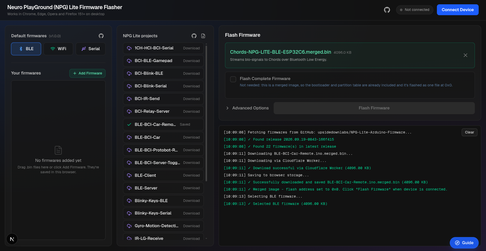

# NPG Lite Flasher Web

Flash firmware to your Neuro PlayGround (NPG) Lite straight from the browser. No Arduino IDE, drivers or command-line tools needed: plug the board in over USB, pick a firmware and click Flash.

**Open the flasher:** https://upsidedownlabs.github.io/NPG-Lite-Flasher-Web/



## Features

- **Default firmwares:** the BLE, WiFi and Serial builds of [Chords](https://github.com/upsidedownlabs/Chords-Arduino-Firmware), always taken from the latest release.
- **NPG Lite projects:** every project from the latest [NPG-Lite-Arduino-Firmware](https://github.com/upsidedownlabs/NPG-Lite-Arduino-Firmware) release, each with a short description of what it does. Download one, or all of them at once.
- **Your own firmware:** add any `.bin` file with the Add Firmware button or by dragging it onto the page.
- **Saved in the browser:** downloaded and added firmwares are stored locally, so they're ready the next time you open the flasher.
- **Automatic flash address:** merged images go to `0x0` and app-only files to `0x10000`, so you don't have to remember offsets.
- **Flash Complete Firmware:** write the bootloader, partition table and app together, for a blank chip or a new partition scheme.
- **Live console** that shows every step of connecting and flashing.
- **Guided tour** that walks you through the page.

## Requirements

- An NPG Lite (ESP32-C6) and a USB cable that carries data, not just power.
- A desktop browser with the Web Serial API:

| Browser | Supported |
| ------- | --------- |
| Chrome, Edge, Opera | Yes |
| Firefox | Yes, from version 151 |
| Safari | No |
| Mobile browsers | No |

The page must be opened over HTTPS (as on the link above) or from `localhost`.

## How to flash

1. Connect the NPG Lite to your computer with a USB cable.
2. Click **Connect Device** and choose the board's serial port in the browser's pop-up.
3. Pick a firmware from one of the lists on the left:
   - **Default firmwares:** BLE, WiFi or Serial.
   - **NPG Lite projects:** click a project to download and select it.
   - **Your firmwares:** a file you added yourself.
4. Click **Flash Firmware** and wait for it to reach 100%. Don't unplug the board while it's flashing.
5. If the board doesn't start the new firmware on its own, press its RESET button, or unplug and replug the USB cable.

## Merged images and Flash Complete Firmware

ESP32 firmware comes in two forms:

| File | What it contains | Written to |
| ---- | ---------------- | ---------- |
| `*.merged.bin` | Bootloader, partition table and app in one file | `0x0` |
| `*.ino.bin` | The app only | `0x10000` |

All default firmwares and NPG Lite projects are merged images, so they're flashed as a single file.

If you flash an app-only file, the board keeps its existing bootloader and partition table. That's fine when the firmware already on the board uses the same partition scheme. For a blank chip, or when the partition scheme changes, turn on **Flash Complete Firmware** and choose all three files:

| Part | File from Arduino IDE | Written to |
| ---- | --------------------- | ---------- |
| Bootloader | `sketch.ino.bootloader.bin` | `0x0` |
| Partition table | `sketch.ino.partitions.bin` | `0x8000` |
| App | `sketch.ino.bin` | `0x10000` |

In Arduino IDE, **Sketch > Export Compiled Binary** creates these files in the sketch's `build` folder.

**Advanced Options** lets you change the flash address of a single file. Only do this if you know the address your file needs: a wrong address can stop the board from booting.

## Troubleshooting

| Problem | What to try |
| ------- | ----------- |
| The board isn't in the port list | Use a USB cable that carries data, try a different USB port, and close any other app using the port (such as the Arduino IDE Serial Monitor). |
| "Web Serial isn't supported" | Use Chrome, Edge, Opera or Firefox 151+ on a desktop computer. |
| Connecting fails or times out | Unplug and replug the board, then click Connect Device again. |
| Flashing finished but the board does nothing | Press RESET, or unplug and replug the USB cable. |
| A firmware won't download | Check your internet connection and try again. You can also download the `.bin` from the GitHub release and add it with Add Firmware. |

## Development

The flasher is a [Next.js](https://nextjs.org/) app written in TypeScript and styled with Tailwind CSS. Flashing uses [esptool-js](https://github.com/espressif/esptool-js).

You need Node.js 20.9 or newer.

```bash
git clone https://github.com/upsidedownlabs/NPG-Lite-Flasher-Web.git
cd NPG-Lite-Flasher-Web
npm install
npm run dev
```

Then open http://localhost:3000 in a supported browser.

| Command | What it does |
| ------- | ------------ |
| `npm run dev` | Starts the development server with live reload |
| `npm run build` | Builds the production site |
| `npm run lint` | Checks the code with ESLint |

### Project layout

| Path | Contents |
| ---- | -------- |
| `app/page.tsx` | The flasher: firmware lists, flashing, console and dialogs |
| `app/components/AppTour.tsx` | The guided tour |
| `app/globals.css` | Global styles, scaling and the tour's look |
| `.github/workflows/deploy.yml` | Builds the site and publishes it to GitHub Pages |

### How firmware is downloaded

GitHub release downloads don't allow requests from other websites (no CORS headers), so the flasher downloads them through two small Cloudflare Workers, one for each firmware repository. Their addresses are set at the top of `app/page.tsx` (`PREBUILT_SOURCE` and `NPG_LITE_SOURCE`). The Workers cache releases and pick up a new release within about a minute.

### Deployment

Every push to a branch other than `dev` builds the site and publishes it to GitHub Pages using `.github/workflows/deploy.yml`.

## Contributing

Bug reports and pull requests are welcome. Please open an [issue](https://github.com/upsidedownlabs/NPG-Lite-Flasher-Web/issues) to describe a problem or an idea before starting on a large change.

## License

This project is licensed under the GNU General Public License v3.0. See [LICENSE](LICENSE) for details.

Made by [Upside Down Labs](https://upsidedownlabs.tech/).
